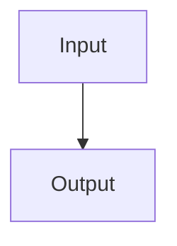

# callumdoty.com

A personal technical publication, built with [Astro](https://astro.build) from Markdown files. There is no database, CMS, or admin dashboard.

```bash
npm install
npm run dev      # http://localhost:4321
npm run build    # static site in dist/
```

Pushing to `main` builds and deploys to GitHub Pages (`.github/workflows/deploy.yml`).

## Publishing

Create one Markdown file. The page, sidebar, breadcrumbs, table of contents, and index listings all update on their own. The file name becomes the URL, so `content/blog/my-article.md` is published at `/blog/my-article/`.

### A project: `content/projects/<name>.md`

```yaml
---
title: Project Name               # required
description: One-sentence summary # required
date: 2026-01-15                  # required
tags: [Python, Forecasting]       # required
github: https://github.com/...    # optional
external_url: https://...         # optional
featured: true                    # optional: list it on the home page
status: In Production             # optional
---
```

Suggested sections, all optional: Overview, Research Question / Objectives, Background / Theoretical Framework, Data & Sources, Methodology, Implementation, Results, Limitations, Future Work.

### An article: `content/blog/<name>.md`

```yaml
---
title: Article Title              # required
description: One-sentence summary # required
date: 2026-01-15                  # required
category: Technical Research      # required
tags: [Bayesian]                  # optional
featured: true                    # optional
---
```

Categories in use: Technical Research, Data & Quantitative Methods, Systems & Engineering, Ideas & Observations. A new category only needs a new value here.

Suggested sections, all optional: Introduction, Background, Main Discussion / Analysis, Conclusion, References.

### An About section: `content/about/<name>.md`

Needs `title` and `description`. An optional `order` sets its position in the sidebar. `content/about/index.md` is the `/about/` page itself, and `content/home.md` is the introduction on the home page.

## Writing

Start at `##`. The page title is already the `h1`. `##` and `###` headings are numbered automatically and appear in the table of contents, so don't type numbers into them.

**Math** always uses double dollar signs. A single `$` stays literal, so `$400 million` is safe to write anywhere.

```markdown
Inline: the win probability $$\Phi_0$$ is computed first.

Display, with the delimiters on their own lines:

$$
\Theta = V_{\text{wait}} - V_{\text{deploy}}
$$
```

**Images** go in `static/images/`. The optional title becomes a numbered caption. Consecutive images with no blank line between them form a grid.

```markdown

```

**Diagrams** use a `mermaid` code block.

````markdown

````

**Code blocks** with a language are syntax highlighted. Tables, links, footnotes, and the rest of GitHub-flavored Markdown all work.

## Layout of this repository

| Path | Purpose |
| --- | --- |
| `content/` | Everything you write |
| `config/site.yaml` | Name, URL, description, and external links |
| `static/` | Files served as-is: images, diagrams, `CNAME`, `robots.txt` |
| `src/pages/` | Page templates and routes |
| `src/layouts/`, `src/components/` | Shared layout: header, sidebar, breadcrumbs, table of contents |
| `src/lib/nav.ts` | The site hierarchy behind the sidebar and breadcrumbs |
| `src/lib/markdown.mjs` | Math, diagram, and figure handling |
| `src/styles/global.css` | All styling |
