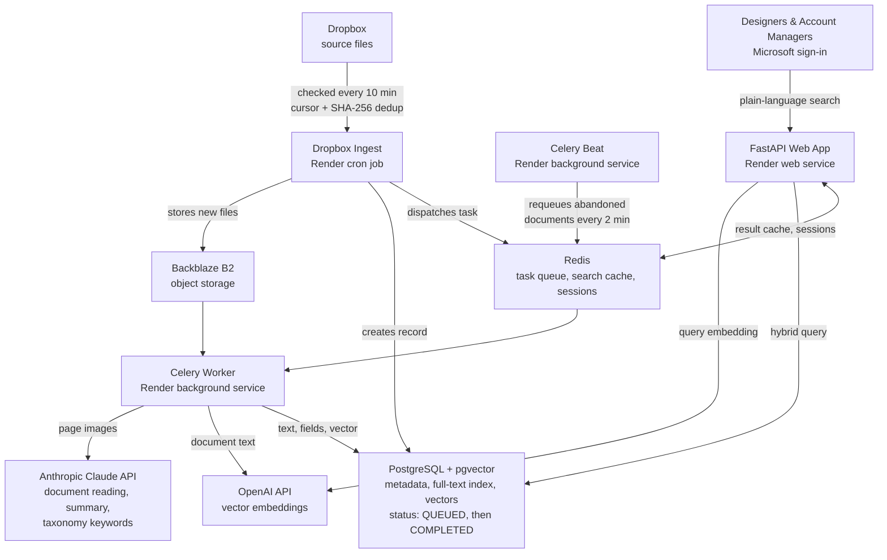

AI-Powered Political File Management System

**Role:** Full-Stack Software Engineer (Sole Developer)\
**Duration:** July 2025 – Present\
**Team:** Solo Project

## Problem

During the 2024 election cycle, designers and account managers estimated they spent 1–5 minutes on each file search in Dropbox. The root issue wasn't search speed. Dropbox could match file names and exact keywords, but there was no way to find past creative work by theme, message, or candidate. Years of campaign work were effectively locked away in folder hierarchies.

## Approach

I designed and built the platform from the ground up:

- **Complete, end to end Use Case Catalog.** Every function, feature, and user interaction was mapped via process flows using Microsoft Visio, paired with a verbose use case document describing each major portion of the application in detail. The high level flows include the end user, Render, background workers, authentication, and share subprocesses. 
- **Multimodal AI pipeline.** PDF pages and images from mailers, digital ads, handouts, and posters are rendered and read by Claude, which returns the text, a summary, and keywords mapped to the taxonomy. A rules layer then resolves client, state, and date from that output, and staff correct uncertain fields in a review queue.
- **Hybrid search.** Each query takes nearest neighbours from a pgvector HNSW index (OpenAI `text-embedding-3-small`) and merges them with PostgreSQL full-text matches, ranked by `0.7 × cosine similarity + 0.3 × ts_rank_cd`. Plain-language queries work alongside filters for client, state, year, and topic.
- **Custom political taxonomy.** 138 terms across 7 categories and 24 subcategories. Each document's keywords are mapped to canonical terms, so different wordings of the same issue land in the same place.
- **Automated Dropbox ingestion.** A cron job checks the current-year Dropbox folder every 10 minutes using a cursor-based incremental sync, skips duplicates by SHA-256, retries failed files with backoff, and queues new work. Designers keep saving files where they always have.
- **Background processing.** Celery and Redis run OCR and AI analysis outside the web app, so a slow document never blocks a search.
- **Production operations.** Four Render services (web app, Celery worker, Celery Beat, and the Dropbox cron job) backed by managed PostgreSQL, Redis, and Backblaze B2 storage. Staff use Microsoft sign-in with admin and staff roles, their actions go to an activity log, and deploys are gated on a CI suite of 400+ tests.

Built and maintained solo over 315 commits.

*Shown with invented sample data. Real client files are confidential.*

## Architecture

## Key Technical Challenges

- **A tuned index the query never used.** In February 2026 I tuned the HNSW index for a 10,000-document catalog (`m=32`, `ef_construction=128`), but the search query computed distance for every row with no `ORDER BY … LIMIT`, the only shape where pgvector uses HNSW. Every semantic search was a sequential scan, so the tuning did nothing for ten weeks. Measured on production today, that scan takes 12–21 seconds against 0.2–1.1 seconds for the index. I rewrote the vector branch to fetch ranked candidates, switched to a `FULL OUTER JOIN` so text-only matches survive, and folded a separate count query into `COUNT(*) OVER()`. The production query plan now confirms the index scan. An earlier slowdown taught me to measure first: I had blamed a cache bug without timing anything, so search now logs each stage.
- **A middleware-ordering bug that failed open.** Login broke on Render with Starlette's `SessionMiddleware must be installed` error. I first blamed the platform and replaced the middleware with a Redis-backed session layer, but the error persisted because `add_middleware` runs last-added-first, so the auth check ran before the session loaded. My error handling made it worse by letting requests through when sessions failed. I fixed the order and made auth fail closed. I later replaced a boot-time Redis check with continuous health polling, so the app recovers from a Redis outage without a restart.
- **A memory crash loop in the workers.** Four Celery processes rendering PDF pages exceeded the container's memory, so the worker restarted about every five minutes and lost the documents in flight. Throughput was 53 documents an hour against a theoretical 250 or so. I cut concurrency to two, recycled worker processes every 10 tasks, saved progress per page so a restarted job resumes, and added a Celery Beat sweep every two minutes to requeue abandoned documents.

## Outcome

Designers can search past campaigns by theme or message instead of file name, and account managers can pull pieces for client requests without walking folder trees. Results come back in a median of 1.3 seconds, against the team's estimate of 1–5 minutes to find a file in Dropbox.

| Metric | Value |
| --- | --- |
| Documents Indexed | 9,828 |
| Search Latency in Production | p50 1.3 s, p95 5.6 s (454 requests, Oct–Nov 2026) |
| Searches Logged | 1,663 since Aug 2025 (630 distinct queries) |
| Ingestion | Dropbox folder checked every 10 minutes |
| Field Accuracy on 50 Hand-Labelled Pieces | Year 31 of 33, State 41 of 50 |
| Built and Maintained | Since July 2025, 315 commits |

Latency includes cache hits and runs on a single-CPU, 2 GB web instance. The logged search count is a floor, because cached repeat searches aren't recorded. Field accuracy measures the rules layer that reads date and state from Claude's text.

## What's Next

- **Semantic recall.** The query asks HNSW for 500 candidates, but pgvector's default `hnsw.ef_search` of 40 caps the scan, and production returns 40 of 9,828 documents. Filters apply after that, so a filtered search can lose most of its semantic matches. I'll raise `ef_search` per query and measure the latency cost.
- **Tail latency.** Common words are the slowest path I've measured: ranking all 7,354 pieces that contain "vote" takes over 4 seconds. I'll use the per-stage timing logs to bring the 5.6-second p95 closer to the median.
- **Relevance evaluation.** Search quality and Claude's tagging don't have a formal evaluation yet. The ranking weights are hand-set and the two scores sit on different scales, so vector similarity tends to dominate. I'll build a judged set of about 30 real queries from the search log and compare these weights against Reciprocal Rank Fusion.
