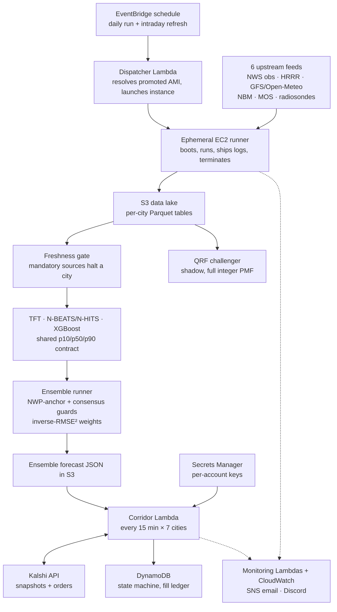

Designing a quantitative decision system that transforms probabilistic weather forecasts into trading decisions under uncertainty — and measuring, honestly, whether those forecasts are good enough to trade.

**Role:** Integration Lead & Temporal Fusion Transformer Engineer\
**Team:** Three-Person Partnership (Equal Ownership)\
**Duration:** February 2026 – Present

## Overview

Prediction markets do not reward accurate forecasts in isolation — they reward identifying when market-implied probabilities are miscalibrated.

This project builds a quantitative trading system for Kalshi's daily high temperature markets. Rather than predicting a single temperature, the system estimates a full probability distribution over outcomes, compares it against the market's implied distribution, and generates trading decisions based on expected value and risk constraints. It launched in a single market and scaled to seven live U.S. metro markets — New York, Los Angeles, Chicago, Miami, Denver, Atlanta, and Las Vegas — within about two months, using a registry pattern where onboarding a new city is a configuration change, not a code change.

The forecasting models are only one layer. The harder engineering problem was the plumbing around them: a shared contract that lets independently developed models operate as one ensemble, a data layer that reconciles six upstream weather sources on different update cadences, and an execution layer disciplined enough to run unattended across seven simultaneous markets with real capital behind it.

The most useful result so far is a measured one rather than a flattering one. Scored on 573 out-of-sample city-days against the de-vigged market, **no forecast source we have — including the production ensemble — beats the Kalshi market in any city**. A quantile regression forest challenger, built in response, cuts the production ensemble's gap to the market by 55%. The rest of this page covers how the system works, how we found that out, and what it changed.

## Research

We started from two hypotheses about where an edge might come from.

**Hypothesis 1: the market under-uses high-resolution data.** Early in the trading window, prices looked anchored to broad public forecasts rather than to higher-resolution numerical weather prediction (NWP) such as HRRR. The benchmark in [Results](#results) rejected this as stated: at the 10 AM ET decision time, the market's distribution beats an honest-lead HRRR forecast decisively, in every city but Denver, where the two tie.

**Hypothesis 2: generic weather models optimize the wrong target.** Kalshi settles on a single number — the official daily maximum at one station — yet most weather models are trained to minimize error across all 24 hourly readings. Every model here is framed around the settlement event itself: the daily maximum, at the settlement station, using only data available before the betting cutoff. That framing turned out to matter more than expected, because "the daily maximum" is less well defined than it sounds (next section).

We also tested several priors before building on them, and threw out the ones that did not survive. Our starting assumption that Central Park reads 5–10°F cooler than LaGuardia measured at −0.92°F. The expected direction of the ASOS sensor's rounding bias was wrong (below). And an experiment re-anchoring one model to predict residuals against HRRR, rather than absolute temperature, remains a switchable option rather than the default.

### Getting the settlement right

Kalshi settles on the National Weather Service Daily Climate Report (CLI), not on the hourly observations most weather datasets carry. Treating those as the same thing is a quiet, systematic error:

- **The CLI reads higher than the hourly feed, and the bias has a direction.** Across 3,452 NYC days the hourly ASOS maximum ran 0.65°F *below* the official CLI high (p < 0.0001), with a modal error of −1°F on 44% of days — the opposite of the warm rounding bias we had assumed. Switching the benchmark's truth from the hourly maximum to the CLI product alone moved the production ensemble's score by 0.0056 RPS.
- **The settlement station is not always the obvious one.** Chicago settles on Midway (CLIMDW), not O'Hare. The original truth table used O'Hare, which disagreed with Midway on 75% of days at a 1.28°F mean error — against brackets only 2°F wide.
- **Some highs happen before you can bet.** On 3.4% of NYC days the official high is set before 10 AM ET, mostly from overnight warm advection in winter and spring.

Every score on this page uses the CLI product as truth, with suspect reports (where the CLI and the observations disagree by more than a threshold) excluded and listed.

## Edge Hypotheses

The system decomposes potential edge into two independent components, and tests each against the market rather than against other weather models.

**Point Forecast Edge** — a better estimate of the expected daily high than the market's implied mean.

**Distributional Edge** — a better-calibrated probability distribution over brackets than the market's prices. Profitability does not require a superior point forecast: a correctly calibrated distribution can generate edge on its own if the market misprices uncertainty. That is why every model is scored on full-distribution proper scoring rules (ranked probability score and log loss over the actual bracket ladder), not on mean absolute error alone.

## System Architecture

The production ensemble combines three independent forecasting models, each built and owned by a different team member, communicating through one shared prediction schema:

- **Temporal Fusion Transformer (TFT)** — PyTorch sequence model using temporal attention over hourly observation and forecast history, with feature engineering that aggregates raw hourly data into lag and rolling-window features while strictly respecting the betting cutoff. It runs once per day as a next-day forecast and contributes its frozen morning forecast to the intraday refresh.
- **XGBoost** — gradient-boosted trees for nonlinear residual correction and feature interactions, retrained from scratch on every inference run (14–26 seconds per city) rather than served from a static checkpoint.
- **N-BEATS/N-HITS** — deep time-series basis expansion (via `neuralforecast`), using historical exogenous features (NWP error terms, rolling temperatures) and future exogenous features (forecast data, cyclical time encodings).

Each model outputs a probabilistic forecast validated against a shared contract, so any of them can be added, removed, or replaced without touching the others or the ensemble layer. A fourth model, a **quantile regression forest (QRF)**, already runs daily through the same contract in shadow: it writes predictions but is deliberately excluded from the ensemble until a pre-registered prospective evaluation reports.

The ensemble weights each model by the inverse square of its recent reported error. Two independent guards run first: one drops any model that diverges sharply from cross-model consensus, and a second drops any model that diverges sharply from an independent HRRR baseline, so a bad forecast can't survive just because another model happens to agree with it. A floor on the uncertainty band stops any one model from making the ensemble overconfident.

Two weighting problems only showed up once the system was live:

- **Cold start for new markets** — a freshly onboarded city has too little prediction history for its rolling error to be trustworthy, and using it anyway penalized the strongest model. New markets run on fixed, empirically chosen weights for their first two weeks, then switch automatically to error-based weighting. This is what let five new markets onboard together without hand-tuning.
- **Self-reported error isn't comparable across models** — each model reports its recent error differently (one from a live backtest, one from raw live residuals, one from a training-time holdout). Measured against observed highs, every model under-reports its error, by 1.27× for XGBoost on average and up to 2.42× for N-BEATS in Denver. The ranking the weights produce is still correct, but the magnitudes are not, so a weekly skill check now scores each model against reality and alerts on the ratio.

### From three quantiles to bracket prices

Kalshi lists a ladder of roughly 2°F brackets plus two open-ended tails, so three quantiles alone cannot price them. The production ensemble fits a normal distribution — mean at the p50, standard deviation from the p10–p90 spread (σ = (p90 − p10) / 2.56) — and integrates it over each bracket's edges. That is simple and stable, but symmetric: it throws away whatever skew the p10 and p90 carried, which matters most in the tails.

The QRF challenger avoids the parametric step. It predicts a dense grid of 2,001 quantiles, builds a probability mass function over integer degrees (the CLI reports whole degrees), smooths it with a narrow kernel so no settled value can receive exactly zero probability, and sums that mass onto the live bracket ladder. A coarser 199-point grid missed four integers of tail support, which is exactly where log loss diverges.

## Risk Management & Decision Layer

Forecasting and capital allocation are treated as separate problems. Execution runs in a single multi-tenant AWS Lambda, invoked every 15 minutes per city during each market's trading window. Each invocation advances a persistent state machine in DynamoDB, so a position built across dozens of independent invocations survives without any long-running process.

The live strategy is a **tethered directional expansion**. In the primary window (the day before settlement), the engine buys only the modal bracket — an anchor sized to a fraction of the day's budget. In a secondary window on the morning of settlement, it compares an intraday refresh forecast to the frozen anchor and expands once, with the remaining budget, toward whichever bracket now contains the refreshed median. If the refresh still agrees with the anchor, it holds.

Independent risk controls sit on top of the raw signal:

- **Divergence filters** — models that deviate sharply from ensemble consensus or the HRRR baseline are excluded from that day's decision.
- **Kelly-based sizing** — position size derived from expected edge, hard-capped at a fixed fraction of bankroll per day.
- **Market-implied volatility gate** — no new exposure when market prices already imply a tight distribution. In practice this is a real filter: on one audited day, five of seven cities never cleared it in the secondary window and simply held the anchor.
- **Cost and liquidity constraints** — no orders into wide spreads, thin books, or baskets above a cost cap.
- **Terminal risk-off** — an adverse collapse in implied volatility ends the day's trading, and nothing downstream can re-open it.

Exact thresholds and calibration constants are intentionally not disclosed.

The benchmark also flagged the secondary window as the weakest spot in the strategy. The refresh forecast is no better than the morning's, yet the market is 21% sharper by then than at the previous morning's cutoff, so the expansion leg commits most of the day's budget at the worst relative position of the day. That finding is what's driving the next iteration of the expansion logic.

## Validation & Backtesting

A central engineering requirement was strict point-in-time correctness: a model may only see data that existed before the trading cutoff for the day being simulated. In practice, the hard part was finding the places where that was quietly false.

**Same-day leakage in the TFT pipeline.** I found that engineered HRRR features included afternoon model runs that already contained the day's high. Restricting aggregation to runs issued before the cutoff closed a gap of **6.8 points of R² and 3.7°F of RMSE** between the leaky and the causal pipeline. That is the size of the advantage a leak can fake.

**Archives that weren't forecasts.** A provenance audit found that several historical tables carried post-cutoff data under forecast column names. Pre-2026 NWP history had come from a reanalysis archive (ERA5), not from forecasts. The stored HRRR history was overwhelmingly lead-1 near-analysis. The NBM proxy's p10–p90 spread was a constant 9.99°F in every year. The raw MOS history was shifted by a day for six of seven cities. Each of these would have flattered any backtest that used it. Those feature groups are now refused in code with their reason attached, and the challenger was rebuilt on genuinely archived forecasts: all-cycle MOS bulletins and true previous-run ECMWF and GFS forecasts.

**A promotion gate that could not promote.** Weekly TFT retraining used a train/validation split frozen at four calendar dates, so every retrain re-optimized the same rows, and the window the gate scored on receded further into the past each week. In one week, NYC's rejected candidate was 21% better than the champion that beat it over the 198 recent days the gate never looked at. The split now rolls with the data (a 60-day test window held out of training and selection, with roughly ten months of validation before it). Promotion also requires a 3% margin, because five independently trained checkpoints scored on identical data spread by about 2.8% from training noise alone.

**Train and serve on the same frame.** The TFT's input scalers are fitted on whatever data frame it is given, and none of them are saved with the weights. Serving had been rebuilding a wider frame than training used, which moved the served p50 by 0.48°F on average for no reason. Each checkpoint now carries the exact bounds it was trained on. Matching them took NYC's RMSE from 5.98°F to 5.77°F.

The validation protocol overall:

- Expanding-window, temporally disjoint folds — no random splits, anywhere
- A 582-city-day market holdout gated behind an explicit flag, because every model scored against it spends some of its statistical power
- Paired bootstrap confidence intervals on every model-versus-market comparison
- A pre-registered prospective evaluation (200 settled city-days and 75 qualifying trades) before any new model's live results are examined
- Regime-aware error analysis (sea breeze, warm advection, pre-dawn highs) and weekly live skill monitoring

## Production Infrastructure (AWS)

The system runs as an automated production pipeline, not a research notebook:

- **Ingestion** — six upstream sources (surface observations, two NWP model families, a blended-model product, MOS bulletins, and upper-air soundings) on different cadences and latencies, normalized to one unit standard and partitioned per city in S3 Parquet. Writes are deduplicated by primary key, so re-runs are safe.
- **Freshness gate** — before inference, each source's age is checked. A stale mandatory source halts that city and alerts; optional sources degrade gracefully.
- **Ephemeral compute** — EventBridge triggers a dispatcher Lambda for the daily run and the intraday refresh. It resolves the currently promoted machine image from a Parameter Store channel (publishing an image never promotes it), then launches an on-demand instance, falling back across 3 instance types × 6 availability zones. The instance boots, runs the pipeline, ships its logs, and terminates.
- **Retraining** — one GPU instance trains both neural models for all seven cities in sequence: 1 instance lifecycle per fortnight instead of 14. It runs on-demand because GPU spot capacity was unavailable across every type and zone we measured. The long-lived host now runs only on Sundays, cutting its duty cycle from 730 to about 134 hours a month.
- **Isolated execution** — the trading Lambda reads only the finished ensemble output and has its own narrowly scoped IAM role, so a bug in model code cannot touch trading credentials, or vice versa. Kalshi keys are per account in Secrets Manager. State, fills, and audit history are in DynamoDB.
- **Release discipline** — trading code deploys through CI: tests, package, snapshot the running version, deploy, smoke-invoke, and roll back on failure. Every prediction records the git commit, machine image, and the content identity of the checkpoint that produced it.
- **Monitoring** — Lambda-based checks for data sources, Kalshi reachability, model skill, and trades. Alerts go out by SNS email, and 14 CloudWatch alarms post to Discord. The monitors are themselves alarmed on not being invoked, because a monitor fails by not running.

## Results

The headline result is a benchmark: every forecast source scored against the de-vigged Kalshi market, read at the 10 AM ET decision time, over the same 573 city-days (June 13 – September 12, 2026, all seven cities, CLI truth).

| Source | RPS | Log loss | Gap to market [95% CI] |
| --- | --- | --- | --- |
| Kalshi market (de-vigged) | **0.092** | 1.27 | — |
| QRF challenger (shadow) | 0.117 | 1.44 | +0.025 [0.017, 0.032] |
| MOS + HRRR blend | 0.125 | 1.54 | +0.033 [0.026, 0.040] |
| Bias-corrected MOS | 0.136 | 1.63 | +0.044 [0.035, 0.053] |
| Production 3-model ensemble | 0.147 | 1.74 | +0.055 [0.046, 0.064] |
| HRRR, honest lead | 0.156 | 1.75 | +0.064 [0.054, 0.074] |

What it says:

- **The market is a strong forecaster.** No source beats it in any city. The two closest calls (Denver for HRRR, Miami for corrected MOS) have intervals spanning zero.
- **The QRF challenger is the best weather-only forecast we have.** It has the lowest RPS of any weather source, 21% below the production ensemble, and closes 55% of the ensemble's gap to the market. In Atlanta, Las Vegas, and Miami it is statistically indistinguishable from the market. In Chicago, Denver, Los Angeles, and New York, the market is still clearly better.
- **The market gets sharper over time, and our forecasts don't.** Between the D-1 cutoff and the next morning's trading window, the market's RPS improves 21% (0.091 → 0.072). The intraday refresh forecast slightly worsens (0.135 → 0.138). It moves in the right direction only 56.5% of the time and overshoots by roughly 2×.

The calibration picture explains why the challenger is promising but not yet tradeable on its own:

Where QRF thinks a bracket is cheap by 20+ points, that bracket settles YES 16% of the time against a 10% market price, roughly two standard errors of real signal. But QRF claimed 39%. The disagreement carries information, about a fifth as much as the model believes. That is why QRF's next stage is a market-conditioned correction that shrinks its disagreements toward the price, rather than trading its raw probabilities.

Live P&L is not published. The benchmark is the cleaner test of whether an edge exists, because it scores every city-day rather than only the days the risk gates let through.

**Engineering metrics**

| Metric | Value |
| --- | --- |
| Live markets / trading-engine cadence | 7 cities, every 15 min |
| Unit tests (run in CI on every push) | 781 |
| Read-only production verification checks | 151 (150 pass, 1 intentional warning) |
| XGBoost full retrain per inference | 14–26 s per city |
| TFT daily aggregation, NYC (content-hashed cache) | 47.5 s → 3.5 s |
| N-BEATS bias backtest, NYC (content-hashed cache) | 34.8 s → 3.9 s |
| Retrain instance lifecycles per fortnight | 14 → 1 |
| Long-lived host hours per month | 730 → ~134 |

## My Contributions

As Integration Lead, I focused on turning independently developed models into a unified production system, and on making sure we measured it honestly. Key contributions:

- Designed the ensemble architecture and the shared probabilistic forecast contract
- Built the Temporal Fusion Transformer pipeline, including the rolling train/validation split, the noise-aware promotion gate, and train-serve frame matching
- Discovered and fixed the same-day HRRR leakage in the TFT pipeline (6.8 points of R², 3.7°F of RMSE)
- Implemented the dynamic ensemble weighting, including the cold-start logic that let five new markets onboard without hand-tuning
- Led the scale-out from one market to seven via a registry-based onboarding pattern
- Built the CLI settlement-truth layer and the forecast-versus-market RPS benchmark
- Audited the historical forecast archives for post-cutoff contamination, and built the QRF challenger on honestly archived data
- Moved the system from a long-lived server to ephemeral, image-pinned compute with CI-gated deploys, rollback, and self-monitoring

## Technologies

**Machine Learning**

- Temporal Fusion Transformer (PyTorch Forecasting)
- XGBoost
- N-BEATS / N-HITS (neuralforecast)
- Quantile Regression Forests (quantile-forest)
- Probabilistic forecasting and ensemble learning
- Proper scoring rules (RPS, log loss, Brier) with paired bootstrap

**Infrastructure**

- AWS EC2 (ephemeral on-demand runners, promoted AMI channels via SSM Parameter Store)
- AWS Lambda and EventBridge
- AWS S3 (per-city Parquet data lake)
- AWS DynamoDB
- AWS Secrets Manager
- AWS SNS and CloudWatch (alerting)
- GitHub Actions (OIDC deploys, smoke tests, rollback)

**Methods**

- Time-series forecasting
- Expanding-window and walk-forward validation
- Point-in-time data provenance auditing
- Probability calibration
- Quantitative risk management (Kelly sizing, volatility gating)
- Feature engineering for spatiotemporal data
